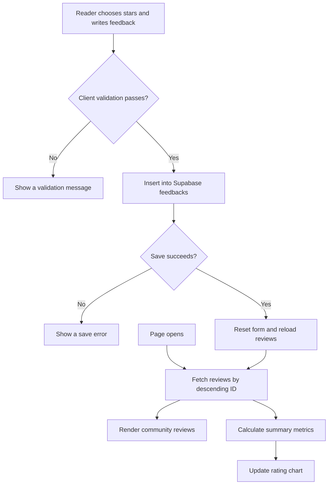

<div align="center">


# Bhai PDFs
### A small review. A better study resource.

**Rate the PDFs. Share your experience. Help shape what comes next.**

A focused feedback portal for student study materials, bringing  
star ratings, written reviews, and visual insights into one experience.

[](https://lokeshkodamanchili.github.io/feedback-site/)
[](script.js)


[The purpose](#made-for-feedback-that-matters) · [Experience](#three-parts-one-feedback-loop) · [How it works](#from-a-review-to-an-insight) · [Setup](#run-it-locally) · [Author](#built-by)

</div>

---

## Made for feedback that matters

Sharing a PDF is only the beginning. Knowing whether it helps students makes the next resource better.

**Bhai PDFs** gives readers a direct way to rate study materials and explain their experience. The portal pairs a simple submission form with a rating dashboard and a community review section, helping the creator understand what is useful and where improvements are needed.

The interface uses **Bhai PDFs** branding; the source comments and footer also refer to the feedback experience as **Pulse Feedback**.

> **The idea:** make student opinions visible, understandable, and useful for improving future study content.

## Three parts. One feedback loop.

| Experience | What it does |
| :--- | :--- |
| **01 / Write** | Choose a rating, add written feedback, and optionally include a name. |
| **02 / Understand** | View the average rating, review count, most common rating, and distribution chart. |
| **03 / Explore** | Read community reviews with star scores, initials avatars, and visual rating bars. |

### Details that make the experience

- **Interactive stars:** five rating levels with hover previews and labels from Poor to Excellent.
- **Optional identity:** blank names are saved as **Anonymous**.
- **Guided writing:** a character counter and input handling for up to 500 characters; submission requires at least five characters of feedback.
- **Submission states:** a disabled button while saving, plus success and error messages.
- **Persistent reviews:** feedback is stored in a Supabase table and loaded in descending ID order.
- **Visual analytics:** a Chart.js bar chart groups responses by one to five stars.
- **Responsive layout:** form and chart adapt to screen size; community reviews expand from one to three columns.

## A visual identity with personality

The website combines a near-black canvas, translucent cards, coral highlights, and teal accents. Animated ambient orbs, a subtle noise texture, and card transitions add depth without changing the simple feedback journey.

| Design element | Implementation |
| :--- | :--- |
| **Canvas** | Near-black background, `#0A0A0F`. |
| **Primary accent** | Coral orange, `#FF6B35`. |
| **Secondary accent** | Teal, `#00D4AA`. |
| **Rating highlight** | Warm yellow, `#FFC845`. |
| **Typography** | Syne for display text; Instrument Sans for body text. |
| **Surfaces** | Rounded glass cards, fine borders, blur, and gradients. |

**[Experience the live design ↗](https://lokeshkodamanchili.github.io/feedback-site/)**

## From a review to an insight



**Refresh behavior:** reviews are fetched when the page loads and after a successful submission in that browser. The current implementation does not subscribe to Supabase Realtime or poll for changes from other visitors.

### What the dashboard measures

| Metric | Calculation |
| :--- | :--- |
| **Average** | Sum of fetched ratings divided by the number of fetched reviews, displayed to one decimal place. |
| **Reviews** | Number of records returned by the query. |
| **Most given** | Rating with the highest response count. Ties resolve to the lower star value. |
| **Rating breakdown** | Response counts for each rating from one to five stars. |

All metrics are calculated in the browser from the returned dataset.

## A lightweight stack

| Technology | Role |
| :--- | :--- |
| **HTML5** | Page structure, feedback inputs, dashboard, and review section. |
| **CSS3** | Design tokens, responsive grids, motion, and glass effects. |
| **JavaScript** | Rating interactions, validation, data requests, review rendering, and calculations. |
| **Supabase JavaScript client** | Browser access to the feedback database. |
| **Chart.js** | Rating distribution visualization. |
| **Google Fonts** | Syne and Instrument Sans typography. |
| **GitHub Pages** | Static website hosting. |

No bundler, package installation, or application server is required. Libraries and fonts are loaded from external services.

## Inside the repository

| File | Responsibility |
| :--- | :--- |
| [`index.html`](index.html) | Website markup and external library imports. |
| [`style.css`](style.css) | Visual system, components, animations, and responsive rules. |
| [`script.js`](script.js) | Supabase connection, submission logic, reviews, statistics, and chart updates. |
| [`logo.jpeg`](logo.jpeg) | Bhai PDFs brand image. |
| [`README.md`](README.md) | Project overview and setup guide. |

## Run it locally

```bash
git clone https://github.com/lokeshkodamanchili/feedback-site.git
cd feedback-site
python -m http.server 8000
```

Open **http://localhost:8000** in your browser.

The interface can also be opened through `index.html`. Internet access is needed for the external libraries, fonts, and Supabase connection.

### Connect your own Supabase project

For an independent copy, create your own Supabase project and configure the `supabaseUrl` and `supabaseKey` values near the top of `script.js`.

The client expects a table named **`feedbacks`**:

| Column | Suggested type | Expected behavior |
| :--- | :--- | :--- |
| `id` | `bigint` | Primary key with an automatically generated value; used for sorting. |
| `name` | `text` | Reviewer name or the fallback value `Anonymous`. |
| `rating` | `smallint` | Star score from 1 to 5. |
| `text` | `text` | Written feedback. |

Configure database constraints for valid ratings and feedback lengths, and enable Row Level Security with policies appropriate for the portal’s intended public read and submission behavior. Database schema migrations and policy definitions are **not included** in this repository.

Use a browser publishable key for the frontend; keep secret or service-role credentials out of client code.

## Current scope and next possibilities

The current app collects feedback for the shared PDF collection as a whole. It does not attach reviews to individual PDF IDs, require sign-in, or include a moderation dashboard.

<details>
<summary><strong>Ideas for a future version</strong></summary>

- **Per-PDF feedback** to compare usefulness across subjects and resources.
- **Moderation tools** for reviewing and managing community submissions.
- **Authentication and submission controls** to support accountable participation.
- **Realtime subscriptions** for synchronized updates across visitors.
- **Pagination and database aggregates** for larger review collections.
- **Feedback exports** for analysis outside the portal.
- **Theme switching** for a choice of light and dark interfaces.

These are potential improvements, not features of the current implementation.

</details>

## Built by

**Lokesh Kodamanchili**

Created to understand how shared study PDFs help students and to guide improvements through their feedback.

**[GitHub profile](https://github.com/lokeshkodamanchili)** · **[Report an issue or suggest an improvement](https://github.com/lokeshkodamanchili/feedback-site/issues)**

---

<div align="center">

### Better resources begin with honest feedback.

**Read. Rate. Reflect.**

[Visit Bhai PDFs ↗](https://lokeshkodamanchili.github.io/feedback-site/) · [Back to top ↑](#bhai-pdfs)

</div>
